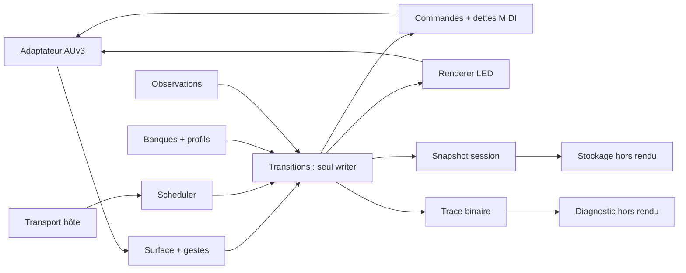

# XONE ENGINE NATIF — comparaison d’architecture du 26/10/2026
Statut : RECOMMANDATION TECHNIQUE, pas validation musicale ni promotion. Base vérifiée : main 5874ae2f29a2543d9df7cda4814803d04dd36257. La mission autorise comparaison et prototype conditionnel ; aucune fusion main.

## Décision proposée
Retenir H : cœur C++17 indépendant d’iOS, à transitions déterministes, plus adaptateur Objective-C++ AUv3. Conserver les frontières métier qui portent une règle ; supprimer les frontières imposées par les instances Mozaic. Ne pas construire un bus logiciel généraliste, un journal event-sourcing ou un réseau de workers.

La centralisation n’est pas une nouvelle idée imposée à la musique : S7/S8 exigent déjà S3 seul écrivain LIVE. Le changement natif retire les sérialisations SysEx et copies GLOBAL nécessaires entre instances, sans retirer validation, staging, refus entier ni dettes de release.

## Alternatives réellement comparées
Échelle qualitative : + favorable, ~ compromis, - défavorable. Ces jugements sont une analyse de structure, pas des mesures de performance.
| Critère | A linéaire | B modules S1–S8 | C native originale | H native + règles extraites |
|---|---|---|---|---|
| Fidélité initiale au code | + proximité textuelle | + frontières familières | - risque de réinterprétation | + règles sourcées, traces comparées |
| Fidélité aux décisions supersédantes | - anciens formats et modes | ~ nécessite corrections ciblées | ~ doit tout requalifier | + spécialisations explicites |
| Temps réel | - timers/copies hérités | ~ appels directs possibles | + si borné, sinon risque framework | + transitions, buffers fixes |
| Complexité finale | - duplications/globals | ~ 8 rôles conservés | - si architecture trop générale | + un writer, services purs |
| Performance | ~ non mesurée | ~ non mesurée | ~ non mesurée | ~ non mesurée |
| Tests PC/CI | ~ extraction requise | + modules isolables | + cœur indépendant | + cœur et corpus par règle |
| Extension profils | - adresses historiques | ~ module S8 encombrant | + données typées | + profil séparé des FX |
| Intégration AUM | même risque de ports pour les 4 variantes | même | même | même |
| Coût de migration | + démarrage rapide, dette élevée | ~ progressif | - redessin global | ~ socle neuf, règles par lot |
| Risque principal | recopier erreurs et limites | cristalliser anciennes frontières | perdre nuances UX | fausse mutualisation entre familles |

A reste utile comme oracle de lecture et pour transcrire une routine isolée dont les conditions sont prouvées. B est un bon point de départ pour nommer les responsabilités, mais conserver toutes ses enveloppes n’apporte rien dans un seul processus. C serait moins bonne si elle ajoutait transactions universelles, événements persistants et workers. H gagne par le scénario concret DOWN→NAV→UP, les états S8 hors snapshots et la suppression du transport interne, pas par élégance.

## Douze domaines, pas douze instances
1. SurfaceInput : décodage physique, identité port/câble/canal/contrôle, validation.
2. GestureState : DOWN/UP, SHIFT90ms, SMART200ms selon S2 ; délais des autres gestes à extraire séparément.
3. StateTransitions : writer unique LIVE/NAV, admission/arbitrage/commit, pickup et ownership.
4. MusicalScheduler : échéances BEAT/BAR/STOP, appels synchrones du même writer.
5. ControlRules : CC/FX/FILTER/FADER/SPOT/TOP/BOT/MUTE/SOLO/DJ, tables distinctes par famille.
6. BankModel : PATCH/MEMORY/CUE/LOAD/PRESET/RED, validité et captures ; aucune émission.
7. InstrumentProfiles : configurations par destination, SAMPLE/DRUMS/FILL, BASE et modes SPOT.
8. ObservationModel : provenance et valeurs réellement observées, UNKNOWN, réconciliation explicite.
9. MidiOutput : traduction logique→binding, dettes et sorties ; un émetteur par domaine.
10. LedRenderer : projection logique et flashes, unique propriétaire de sortie K2.
11. SessionStore : schéma versionné, images immuables, validation hors rendu.
12. HostAdapterDiagnostics : AUv3/AUM, horodatage et trace binaire ; simulateur hors callback.

Ce découpage est logique : pas douze threads ni douze classes obligatoires. Scheduler et banques restent des structures du moteur. Le prototype ne prétend implémenter que quelques mécanismes de 3/4/8/9.

## Données et ownership
EngineState possède LIVE, NAV, engagements MEMORY, pending, dettes et générations. Les API métier reçoivent des vues const ; seul apply(event) publie une transition.
Séparer SourceId (tranche XONE), DestinationId (d0..10), VoiceId, ParameterId, BankOwnerId et PhysicalControlId : aucune égalité numérique implicite.
KnownValue = validité + valeur ; UNKNOWN ne se code pas par zéro. CommandedValue et ObservedValue sont deux champs séparés.
GestureToken = origine physique + identité de pression + destination/configuration au DOWN. Release utilise le token, jamais NAV courant. Un rechargement ne recrée pas un DOWN.
Pending = opération, source, cible capturée, échéance, ordre accepté, génération et payload préparé. Deux sources indépendantes gardent deux pending. C01 remplace une demande successive admissible ; C03 choisit la première dans une opération composite identifiée ; ne pas définir une fenêtre temporelle arbitraire. C04 valide l’ensemble du snapshot avant mutation.
LIVE et dernier LIVE sauvegardé de session sont distincts des PATCH1..3 et de la référence instrument originale.
InstrumentConfig contient les modes MACHINE ET SAMPLE : exclus de PATCH, BASE, MEMORY instrument, PRESET et RED selon spécialisations S8. Ne pas étendre cette exclusion aux SPOT FX/INIT.
SampleState[8] possède chacun CC[12], SpotState[12]. Les bus communs ne sont pas des alias des voix. DRUMS[8] et FILL[8] ont destinations fixes distinctes et PATCH[3] par voix.
Les dimensions historiques 40/42/84, 1328 et 2047 servent à tracer l’ancien format ; elles ne dictent pas les nouveaux structs. Banques S8 initiales vides/invalides ; aucun import implicite S7.

## Événements et transitions
Event = temps hôte en échantillons + séquence + origine + type + données bornées. Les événements déjà ordonnés sont consommés sans tri allouant. L’adaptateur fusionne transport et MIDI selon une règle documentée ; le prototype reçoit un ordre explicite.
Étapes : normaliser→qualifier→résoudre cible→valider→préparer→commit à échéance→émettre. Ces étapes sont des appels directs ; aucun SysEx interne.
À l’échéance : vérifier encore génération/validité, fermer les commandes temporaires de l’ancienne cible, appliquer l’état préparé, émettre les nouvelles commandes et projeter LED. Aucune fermeture anticipée lors de la simple demande.
STOP annule les pending selon contrat et sert les dettes dues, sans produire de faux UP ni effacer les banques. Le vrai UP ultérieur reste consommé.
Feedback : une entrée marquée feedback et provenant d’un binding vérifié met à jour ObservedValue. Un CC générique sans provenance/corrélation suffisante ne confirme pas le dernier TX.

## Scheduler
Utiliser musicalContextBlock et transportStateBlock mis en cache avant rendu. Position/barre/signature manquante = temps inconnu, pas BAR inventé. Tester tempo variable, saut/loop, changement de signature, frontière exacte, STOP à même échantillon, transport arrêté.
BEAT et BAR gardent leurs opérations propres ; une requête arrivée sur la frontière a une règle d’inclusion à extraire de l’oracle. Les numéros BAR du prototype sont injectés par le test ; il ne calcule pas les positions AUM.
L02 ne doit pas ajouter une horloge wall-clock concurrente à l’hôte.

## Ports MIDI et AUM
Apple expose MIDIOutputNames et un numéro de câble dans AUMIDIOutputEventBlock. Le guide AUM décrit plusieurs entrées/sorties d’un nœud et une matrice MIDI. Cela justifie un essai multi-sorties, pas la certification de 11 ports dans cette version AUM.
Candidat à tester : sorties nommées CONTROL_LEGACY, INSTRUMENT_d0..d10, K2_LED ; les identités sont logiques, sans canaux inventés. Ajouter uniquement les sorties effectivement utiles aux bindings.
Alternative minimale : une sortie de contrôle et fan-out AUM avec filtres de canaux/CC, si le registre de bindings prouve absence de collision ; LED séparée. Un flux commun identique vers plusieurs instruments ne suffit pas à les distinguer.
Les contrôles d’AUM (bypass, mix, paramètres hébergés) passent par sa destination MIDI Control et des bindings Learn configurés ; un AUv3 ne peut pas appeler directement un autre AUv3 arbitraire ni lui inventer une adresse. Les ports CoreMIDI de l’app compagnon ne sont pas la solution par défaut.
Feedback : isoler route/provenance. Plusieurs entrées/câbles ne prouvent pas que l’hôte transmet une identité de port externe ; tester cette propriété. Sinon exiger adresses non ambiguës ou adaptateurs de feedback explicites. Pas de déduction basée sur un délai d’écho.
Recette : afficher noms et câbles dans AUM, envoyer deux messages identiques sur deux câbles vers deux moniteurs, vérifier absence de fuite et LED isolée, save/reopen, puis NoteOff d’origine. Tant que ce test manque, ports natifs = NON_TESTÉ.
Sources : https://developer.apple.com/documentation/audiotoolbox/auaudiounit/midioutputnames ; https://developer.apple.com/documentation/audiotoolbox/aumidioutputeventblock ; https://kymatica.com/aum/help

## Temps réel, stockage et diagnostics
Le rendu est single-writer. Pas de mutex, disque, réseau, formatage ou allocation imprévisible. Capacités calculées d’après scènes réelles ; le prototype utilise de petites capacités déclarées pour tester les refus, pas pour fixer les capacités V1.
UI→moteur : file SPSC bornée si un seul producteur ; si plusieurs producteurs, les sérialiser hors rendu. Moteur→UI : snapshots/trace avec publication atomique et ownership documenté. Ne pas rendre atomique chaque champ LIVE.
Réserver capacité d’une transition ET de ses sorties avant mutation. Si saturation : refuser nouvelle opération entière, compter l’incident, conserver dettes ; ne jamais jeter un NoteOff. Drainer les dettes prioritaires avant nouvelles activations. Politique d’arrêt sûr à éprouver sous charge.
Trace binaire fixe RX_IN/DECISION/TX_OUT/RX_FEEDBACK, sans chaîne formatée en rendu. Un worker formate/exporte. Une trace perdue incrémente un compteur ; elle ne prouve pas une sortie livrée.
État AUv3 : fullState capture une image cohérente versionnée, jamais une lecture concurrente de LIVE mutable. Restaurer au point de synchronisation, conserver banques et modes. Corruption/incompatibilité = refus ; pas d’init zéro silencieuse.
Spécialisation Roland : restaurer automatiquement le dernier LIVE sauvegardé quand profil/route prêts, y compris modifications non sauvées en PATCH, sans confondre cela avec BASE/RESET au chargement. Livraison MIDI ≠ confirmation physique ; readiness réelle encore à tester.

## Mutualisation et migration
La duplication du socle d’initialisation GOLDEN peut devenir tables/valeurs initiales partagées après comparaison. Les paramètres INST/YELLOW et DRUMS/FILL peuvent partager des algorithmes paramétrés, pas leurs états ni leurs owners.
Les règles divergentes (faders, filtres, page spéciale, bus, couleur, échéance, PATCH/BASE, SPOT instrument/FX) restent dans des tables explicites ou fonctions spécialisées. Ne pas fusionner par similarité de noms.
Ordre conservé : 8 étapes/16 lots. Insérer comparaison et prototype structurel dans E1 ; L03–L16 gardent leur périmètre. L01 doit relier chaque règle à source, comportement attendu et test. Ni compteur de handlers ni test compilé ne clôturent cette preuve.
Tests d’équivalence : fixtures d’événements + état initial + commandes attendues indépendantes ; GOLDEN pour non-supersédé, contrats spécialisés pour deltas ; comparaison des états ET ordres/échéances/dettes. Conserver corpus L09 74+14+20 sans le renommer PASS natif.
L02 : après gate L01, convertir adaptateur .m en .mm, raccorder premier module réel minimal, traçage hors rendu, workflow iOS distinct et IPA candidate ; aucune modification de l’IPA V0.1.

## Questions techniques qui bloquent un périmètre
1. Couverture sémantique des 382 handlers et clauses des contrats : extraction et fixtures à terminer avant L01 clos.
2. Registre réel de bindings FX/instrument/reset et topologie ports : bloque émissions correspondantes, pas cœur simulé.
3. Readiness/feedback Roland et profil complet : bloque restauration matérielle prouvée, pas banques locales.
4. Scheduler AUM exact et comportement stop/bypass : bloque PASS timing hôte.
5. Persistance fullState cohérente : bloque PASS session, pas test de transition.
Aucune question UX déjà fermée n’est rouverte.
